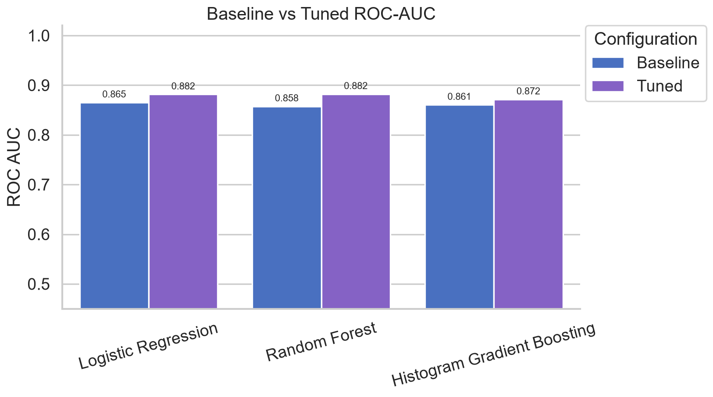
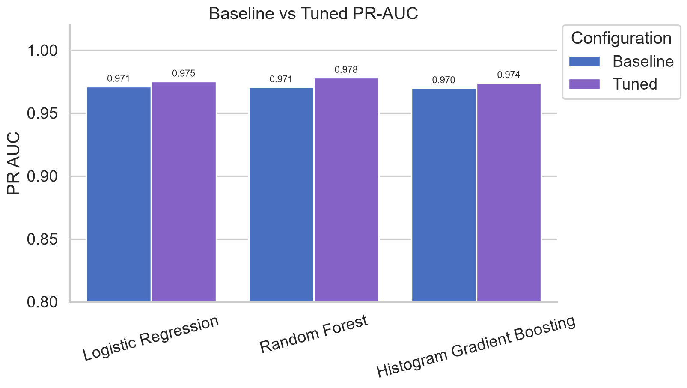
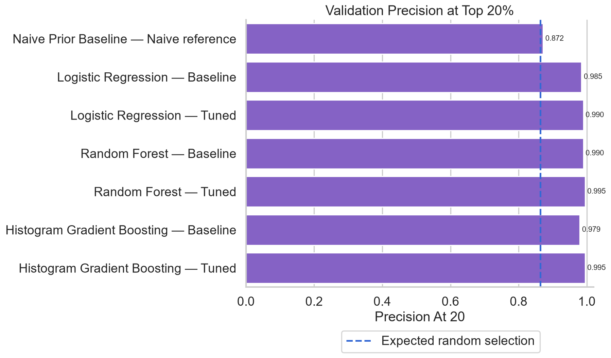
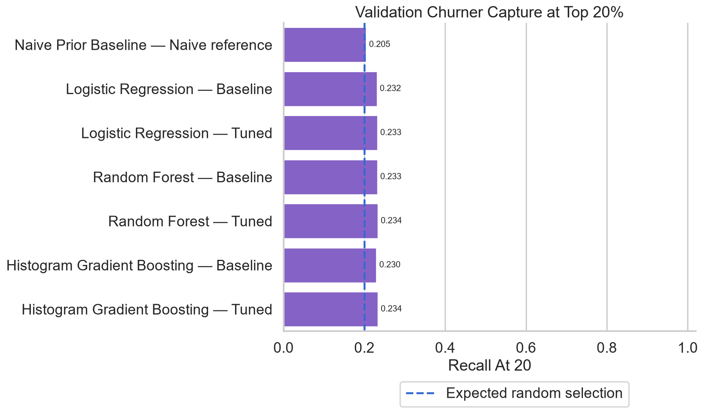
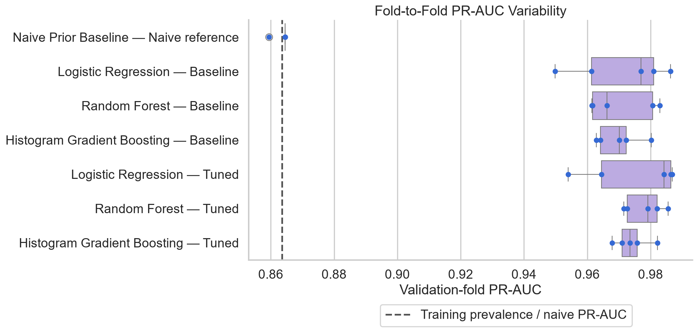

# Phase 5 — Model Development Report

## 1. Executive Summary

Phase 5 developed and compared three leakage-safe churn classifiers using only the fixed 960-row training partition. A prior-probability dummy classifier was retained as a reference. All feature engineering, imputation, scaling, one-hot encoding, and model fitting occurred inside the same five stratified cross-validation folds.

The tuned Random Forest is the provisional candidate. It achieved the highest mean validation PR-AUC (**0.9782 ± 0.0060**), mean ROC-AUC (**0.8822**), and mean precision at the highest-risk 20% (**0.9949**). Its full training-only out-of-fold ranking contacted 192 customers and included 191 observed churners. The result is promising for prioritization, but it is not a final-test estimate and does not demonstrate that contacting a customer will prevent churn.

## 2. Modeling Objective

The business can contact only 20% of customers. Model selection therefore emphasizes probability-based ranking, PR-AUC, ROC-AUC, precision and churner capture within the top 20%, stability, and operational complexity. Accuracy is supplementary: because churn is the 86.35% majority class in training, a model that predicts churn for everyone would already appear 86.35% accurate while providing no useful risk ordering.

The positive class is `churn = 1`; `customer_id` is an identifier and is never a predictor.

## 3. Dataset and Training Strategy

- Fixed Phase 2 training partition: **960 rows** (829 churn, 131 non-churn)
- Sealed final-test partition: **240 rows**, not loaded into model evaluation or selection
- Training dataset fingerprint: `df788deba598b73abdc3a41b8a1947af63a90c5f369c2a498386a2c0eefeb769`
- Split strategy: the saved 80/20 stratified split with random seed 42
- Development strategy: five-fold stratified cross-validation on training rows only

The notebook verifies the cleaned-data fingerprint and the stored split before fitting. Original data, cleaned data, and split indices are not modified.

## 4. Feature Engineering Integration

Every candidate is a complete scikit-learn pipeline:

`predictor DataFrame → CustomerFeatureEngineer → ColumnTransformer → estimator`

The Phase 4 transformer adds `tenure_years`, `complaints_per_active_month`, `payment_risk_score`, `complaint_satisfaction_interaction`, `monthly_contract_tenure`, `late_payment_charge_interaction`, and `usage_per_charge`. Numerical values are median-imputed and scaled; categorical values receive an explicit missing category and one-hot encoding with unknown categories ignored. The preprocessing output is dense and numeric, making it compatible with `HistGradientBoostingClassifier`. All learned transformations are fitted independently within each training fold.

## 5. Baseline Models

| Model | Mean precision | Mean recall | Mean F1 | Mean ROC-AUC | Mean PR-AUC | PR-AUC SD | Accuracy |
|---|---:|---:|---:|---:|---:|---:|---:|
| Naive prior reference | 0.8635 | 1.0000 | 0.9268 | 0.5000 | 0.8635 | 0.0023 | 0.8635 |
| Logistic Regression | 0.9028 | 0.9614 | 0.9311 | 0.8653 | 0.9711 | 0.0151 | 0.8771 |
| Random Forest | 0.8837 | 0.9891 | 0.9334 | 0.8575 | 0.9706 | 0.0104 | 0.8781 |
| Histogram Gradient Boosting | 0.9082 | 0.9650 | 0.9357 | 0.8606 | 0.9699 | 0.0070 | 0.8854 |

The dummy model reproduces the prior and predicts the positive majority class at the default decision rule. Its ROC-AUC of 0.5 confirms that it cannot rank customers meaningfully despite its superficially high accuracy and F1.

## 6. Cross-Validation Strategy

All models use the same materialized `StratifiedKFold(n_splits=5, shuffle=True, random_state=42)` folds. Each validation row is scored by a pipeline fitted without that row. Metrics for positive class 1 are precision, recall, F1, ROC-AUC, Average Precision (PR-AUC), and supplementary accuracy. Ranking metrics are calculated separately inside each validation fold. Using identical folds makes comparisons paired and reduces dependence on one arbitrary train/validation split.

## 7. Hyperparameter Tuning Methodology

`RandomizedSearchCV` evaluated **16 configurations per model**, for **48 configurations and 240 fold fits** in total. The search used the fixed five folds, `random_state=42`, multi-metric scoring, and refit by Average Precision. Searches were deliberately bounded to keep runtime proportionate to the 960-row dataset.

| Model | Best parameters | Runtime (s) |
|---|---|---:|
| Logistic Regression | `C=0.1`, `l1_ratio=1.0` (L1 with liblinear), `class_weight=None` | 8.2 |
| Random Forest | `n_estimators=400`, `max_depth=None`, `max_features=0.5`, `min_samples_split=10`, `min_samples_leaf=2`, `class_weight=balanced` | 67.3 |
| Histogram Gradient Boosting | `learning_rate=0.03`, `max_iter=80`, `max_leaf_nodes=31`, `min_samples_leaf=10`, `l2_regularization=0.1`, `max_depth=None`, `class_weight=None` | 61.6 |

No search trial failed and no model-fitting or convergence warning remained in the final execution. Windows/Jupyter emitted non-model transport notices during command-line execution.

## 8. Class Imbalance Considerations

Churn is the majority class, so “balanced” weighting increases the relative importance of the 131 non-churn rows rather than assuming churn is rare.

| Model | Class weight | Precision | Recall | F1 | ROC-AUC | PR-AUC |
|---|---|---:|---:|---:|---:|---:|
| Logistic Regression | None | 0.9028 | 0.9614 | 0.9311 | 0.8653 | 0.9711 |
| Logistic Regression | Balanced | 0.9579 | 0.7914 | 0.8663 | 0.8654 | 0.9709 |
| Random Forest | None | 0.8837 | 0.9891 | 0.9334 | 0.8575 | 0.9706 |
| Random Forest | Balanced | 0.9193 | 0.9433 | 0.9309 | 0.8701 | 0.9732 |
| Histogram Gradient Boosting | None | 0.9082 | 0.9650 | 0.9357 | 0.8606 | 0.9699 |
| Histogram Gradient Boosting | Balanced | 0.9174 | 0.9349 | 0.9259 | 0.8636 | 0.9686 |

Balanced weights mainly trade recall for precision. They modestly improved Random Forest ranking metrics, but did not improve Logistic Regression or Histogram Gradient Boosting PR-AUC. No resampling was used. The final operating threshold remains a Phase 6 decision.

## 9. Baseline vs Tuned Model Comparison

| Model | Stage | Precision | Recall | F1 | ROC-AUC | PR-AUC | PR-AUC SD | Precision@20% | Recall@20% |
|---|---|---:|---:|---:|---:|---:|---:|---:|---:|
| Naive prior | Reference | 0.8635 | 1.0000 | 0.9268 | 0.5000 | 0.8635 | 0.0023 | 0.8718 | 0.2051 |
| Logistic Regression | Baseline | 0.9028 | 0.9614 | 0.9311 | 0.8653 | 0.9711 | 0.0151 | 0.9846 | 0.2316 |
| Logistic Regression | Tuned | 0.8890 | 0.9843 | 0.9342 | 0.8816 | 0.9752 | 0.0151 | 0.9897 | 0.2328 |
| Random Forest | Baseline | 0.8837 | 0.9891 | 0.9334 | 0.8575 | 0.9706 | 0.0104 | 0.9897 | 0.2328 |
| Random Forest | Tuned | 0.9451 | 0.8626 | 0.9014 | 0.8822 | 0.9782 | 0.0060 | 0.9949 | 0.2340 |
| Histogram Gradient Boosting | Baseline | 0.9082 | 0.9650 | 0.9357 | 0.8606 | 0.9699 | 0.0070 | 0.9795 | 0.2304 |
| Histogram Gradient Boosting | Tuned | 0.8969 | 0.9638 | 0.9291 | 0.8715 | 0.9741 | 0.0054 | 0.9949 | 0.2340 |

The selected Random Forest's lower default-threshold recall and accuracy are not contradictions: tuning optimized probability ranking rather than the unselected 0.5 operating threshold.

## 10. ROC-AUC and PR-AUC Results

All three learned models substantially outperform the naive reference. Tuned Random Forest has the highest PR-AUC (0.9782) and ROC-AUC (0.8822), followed closely by tuned Logistic Regression (0.9752 and 0.8816). PR-AUC is primary because it directly evaluates the quality of the positive-class ranking across thresholds, although the high positive-class prevalence means its naive baseline is also high.

## 11. Top-20% Ranking Analysis

Within every validation fold, contact count is `ceil(0.20 × fold size)`. Probabilities are sorted descending with a stable sort; exact ties retain original fold order. The expected random baseline is fold prevalence for precision and the contacted fraction for recall.

The tuned Random Forest and tuned Histogram Gradient Boosting tie on mean fold-level precision@20% (**0.9949**) and recall@20% (**0.2340**). Tuned Random Forest's mean lift is **1.1521**. Using one out-of-fold score per training row, its aggregate 192-person contact list contains 191 observed churners: precision **0.9948**, churner capture **0.2304**, and lift **1.1520** against training prevalence **0.8635**. Random selection of 20% would be expected to capture roughly 20% of churners.

These figures measure targeting efficiency, not intervention uplift or causal retention impact.

## 12. Fold-to-Fold Stability

The tuned Random Forest's PR-AUC standard deviation is 0.0060, much lower than tuned Logistic Regression's 0.0151 and close to tuned Histogram Gradient Boosting's 0.0054. Its ROC-AUC standard deviation is 0.0229. The small sample, only 131 non-churn examples, and five folds still limit certainty; final-test evaluation is required.

## 13. Selected Provisional Model

The provisional candidate is the tuned Random Forest with 400 trees, unrestricted depth, 50% feature sampling, minimum split size 10, minimum leaf size 2, balanced class weights, and random seed 42. The complete fitted training pipeline is stored locally at `models/phase5_candidate_model.joblib`. It is explicitly a Phase 5 candidate, not the final deliverable model.

## 14. Model Selection Rationale

Random Forest was selected because it has the highest mean PR-AUC and ROC-AUC, shares the best top-20% ranking results, and shows low fold-to-fold PR-AUC variation. It handles nonlinearities and interactions that the Phase 3 analysis suggested. The simpler Logistic Regression remains competitive and is a useful fallback if interpretability or deployment cost outweighs the small ranking gain. Histogram Gradient Boosting is similarly stable but did not match Random Forest's overall AUC results.

## 15. Limitations

- The final 240-row test partition has not been evaluated; all reported metrics are training-CV estimates.
- Hyperparameters were selected using the same available training data, so the saved out-of-fold scores can retain model-selection optimism.
- High churn prevalence makes strong top-20% precision easier to achieve and limits lift above the random precision baseline.
- Default-threshold metrics do not define the future operating point, and probability calibration has not been assessed.
- Temporal availability of usage, satisfaction, complaint, and payment-history predictors still requires business confirmation.
- The dataset is small, particularly for the non-churn class, and represents one observed sample.
- Observed churn ranking is predictive, not causal; effectiveness and cost of retention actions are unknown.

## 16. Phase 6 Evaluation Plan

After approval, Phase 6 should freeze the candidate choice, evaluate calibration using training-derived methods, select an operating threshold or top-20% policy from training/OOF evidence, perform exactly one final evaluation on the sealed test partition, compare calibrated and uncalibrated probabilities where appropriate, report confidence and subgroup diagnostics, and document the final artifact. Explainability and retention simulation should only follow the authorized Phase 6 scope.

Detailed machine-readable results are in `reports/modeling/`. Customer-level out-of-fold scores and the serialized candidate remain local and Git-ignored.
