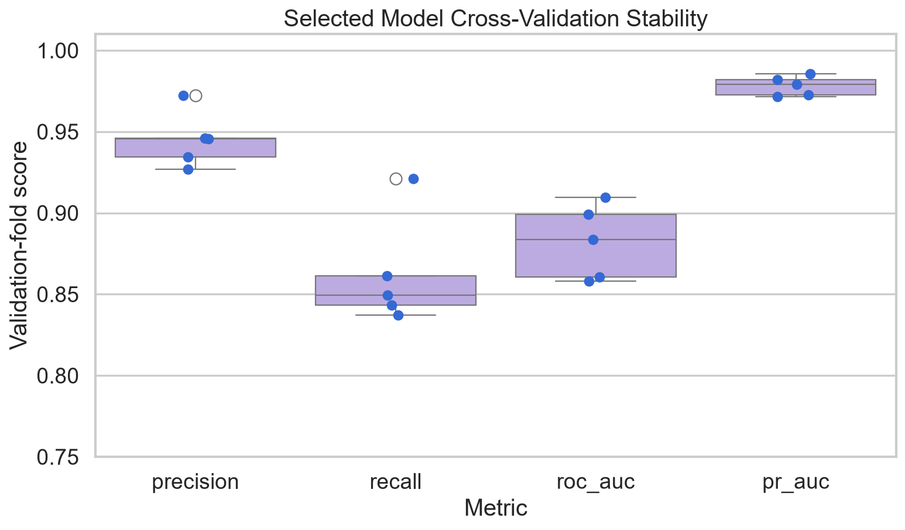
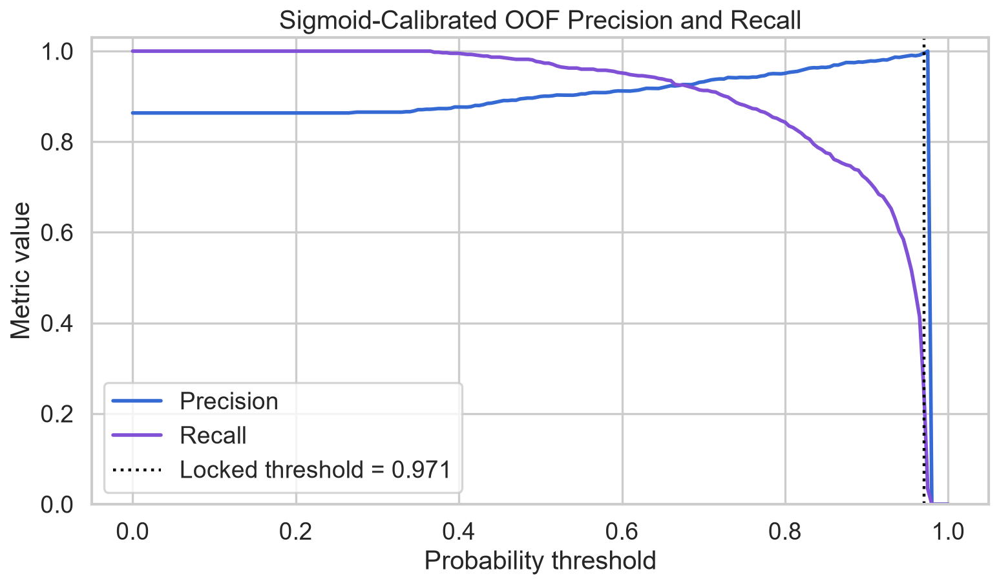
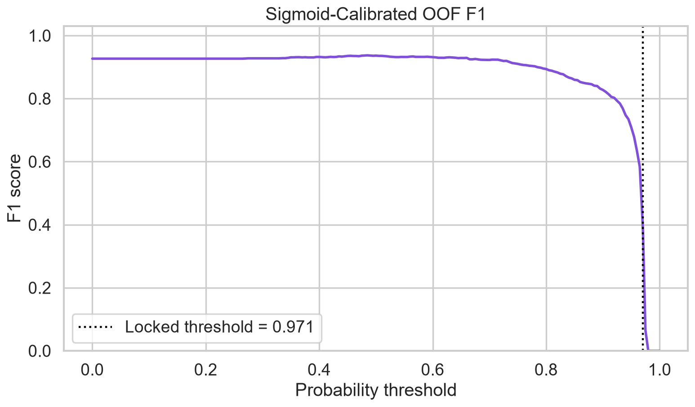
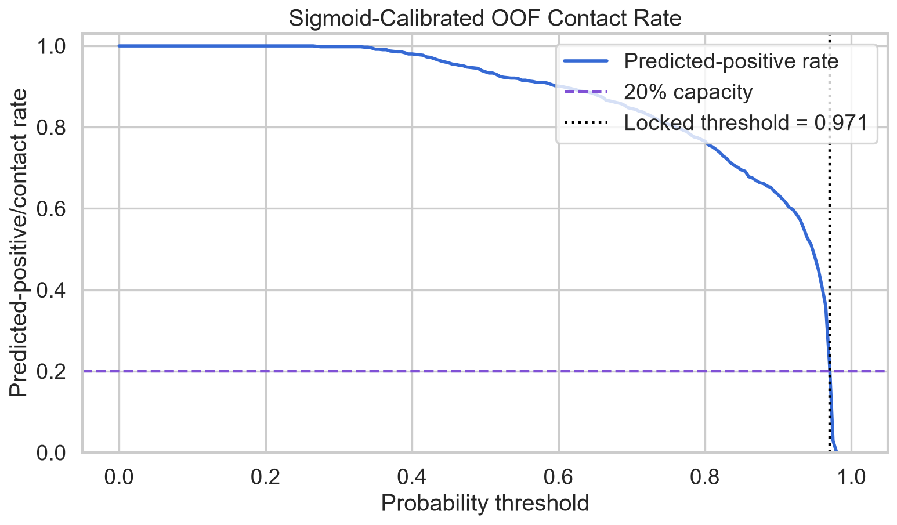
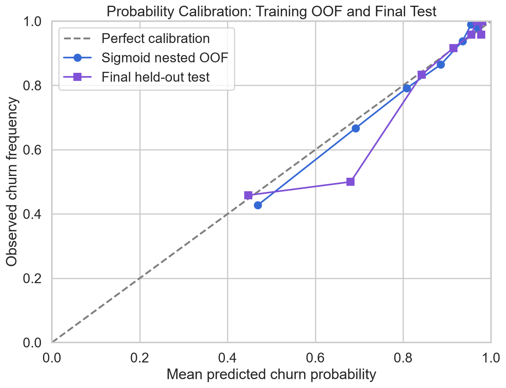
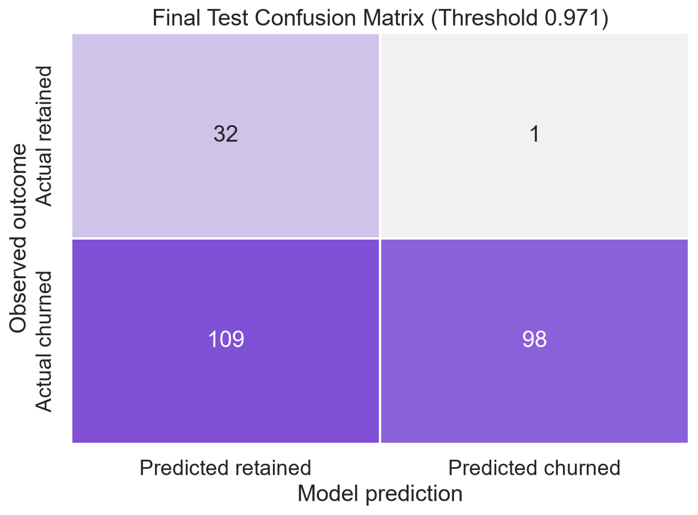
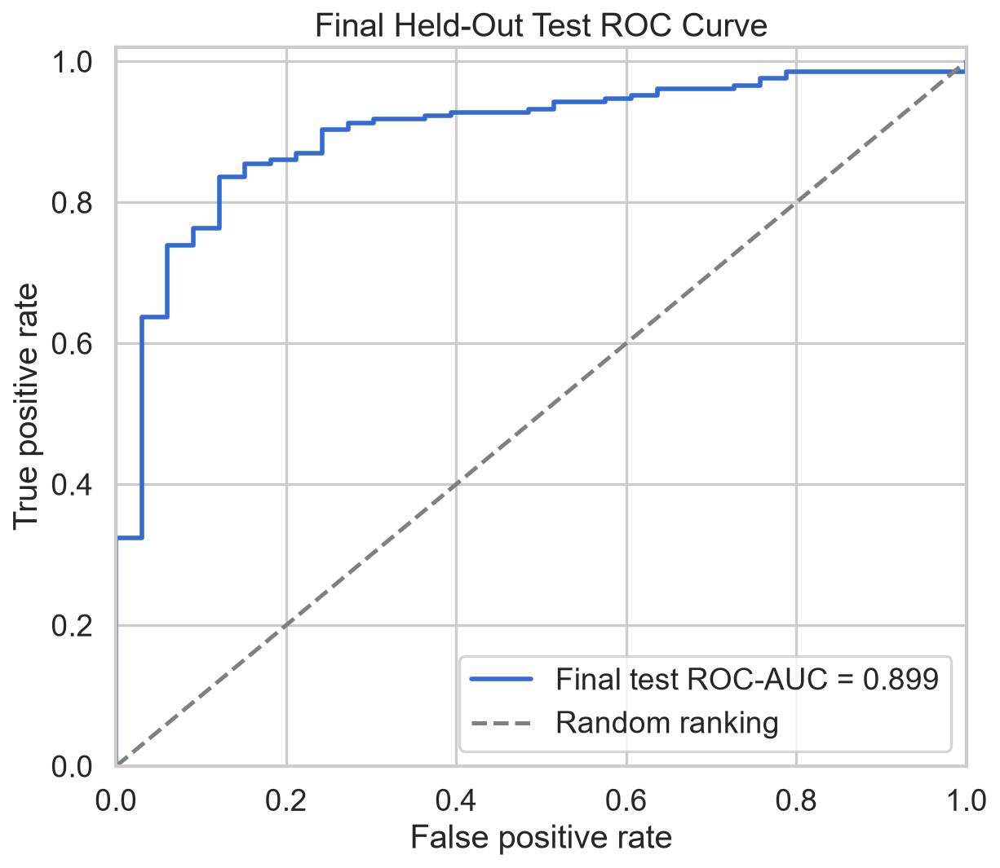
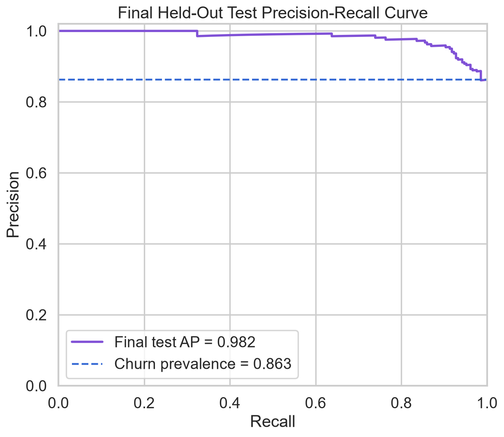

# Phase 6 — Model Evaluation Report

## 1. Executive Summary

Phase 6 retained the Phase 5 tuned Random Forest, preserved balanced class weighting, compared probability calibration methods using nested training-only cross-validation, selected a fixed operating threshold from out-of-fold (OOF) predictions, locked the complete policy, and then evaluated it on the previously sealed 240-row test partition.

Sigmoid calibration was selected because it reduced training-only OOF Brier score from **0.1061** to **0.0840**, log loss from **0.3328** to **0.2752**, and expected calibration error from **0.1181** to **0.0219**, while slightly improving ranking metrics. The locked threshold is **0.970709**, selected to maximize OOF churn recall while keeping OOF contact volume at or below 20%.

On the final test set, the calibrated model achieved ROC-AUC **0.8994**, Average Precision **0.9819**, Brier score **0.0825**, and log loss **0.2627**. At the locked threshold, precision was **0.9899**, recall **0.4734**, F1 **0.6405**, and accuracy **0.5417**. The threshold contacted **41.25%** of test customers rather than 20%, demonstrating that a fixed probability cutoff does not guarantee future capacity. The threshold was not revised after seeing this result.

## 2. Business Objective

The model must identify customers likely to churn while the retention team can contact at most 20% of a campaign population. Phase 6 evaluates classification, ranking, probability reliability, and threshold behavior. It does not estimate whether an intervention will prevent churn or whether a campaign is profitable.

The positive class remains `churn = 1`; `customer_id` remains excluded from predictors.

## 3. Selected Model

The final estimator preserves the actual Phase 5 winner:

- Model: Random Forest
- Trees: 400
- Maximum depth: unrestricted
- Features considered per split: 50%
- Minimum split size: 10
- Minimum leaf size: 2
- Class weighting: balanced
- Random seed: 42
- Calibration: sigmoid through `CalibratedClassifierCV`

Each calibrated constituent contains the full predictor-only feature-engineering, imputation, scaling, one-hot encoding, and classification pipeline. The Phase 5 candidate was not overwritten.

## 4. Data Split Integrity

- Training rows: **960**
- Final test rows: **240**
- Training/test row overlap: **0**
- Dataset fingerprint: `df788deba598b73abdc3a41b8a1947af63a90c5f369c2a498386a2c0eefeb769`
- Split artifact SHA-256: `4325cbfeb6523b8594174ef19926790c08114ca360a78dbe2701378e4fd0a235`
- Target mapping: `0 = retained`, `1 = churned`

Model architecture, hyperparameters, imbalance treatment, calibration method, threshold, metric definitions, and random seed were written to a locked machine-readable configuration before test outcomes were materialized. The lock file remained unchanged through test evaluation.

## 5. Class Imbalance

The training partition contains **829 churned customers (86.35%)** and **131 retained customers (13.65%)**, a majority-to-minority ratio of **6.33:1**. Churn is the majority class.

Accuracy alone is insufficient: an always-churn classifier would already achieve 86.35% training accuracy without ranking customers. Phase 5 found that balanced weights improved the selected Random Forest's PR-AUC and ROC-AUC while changing its precision/recall trade-off. That previously selected treatment was retained; no SMOTE or additional resampling was introduced.

## 6. Evaluation Metrics

- Accuracy: overall correct classification rate.
- Precision: fraction of predicted churners who actually churned.
- Recall: fraction of actual churners identified.
- F1: harmonic balance of precision and recall.
- ROC-AUC: discrimination across all thresholds.
- Average Precision: non-interpolated precision-recall ranking summary. It is not a trapezoidal PR area.
- Brier score: mean squared probability error; lower is better.
- Log loss: strongly penalizes confident incorrect probabilities; lower is better.
- Confusion matrix: counts of true/false positives and negatives.

Average Precision is interpreted relative to churn prevalence, which is already high: 86.35% in training and 86.25% in the final test set.

## 7. Cross-Validation Findings

The selected tuned Random Forest's five Phase 5 validation folds show:

| Metric | Mean | SD | Minimum | Maximum |
|---|---:|---:|---:|---:|
| Precision | 0.9451 | 0.0173 | 0.9268 | 0.9724 |
| Recall | 0.8626 | 0.0340 | 0.8373 | 0.9212 |
| ROC-AUC | 0.8822 | 0.0229 | 0.8582 | 0.9096 |
| PR-AUC | 0.9782 | 0.0060 | 0.9716 | 0.9855 |

PR-AUC was stable across folds. Recall and ROC-AUC varied more, which is plausible given only 131 retained training observations.

## 8. Threshold Analysis

Threshold metrics were calculated from sigmoid-calibrated nested OOF probabilities. Scores equal to a threshold are classified positive. Undefined precision is set to zero when no rows are predicted positive.

| Threshold | Contact count | Contact rate | Precision | Recall | F1 | FP | FN |
|---:|---:|---:|---:|---:|---:|---:|---:|
| 0.50 | 899 | 93.65% | 0.8999 | 0.9759 | 0.9363 | 90 | 20 |
| 0.70 | 812 | 84.58% | 0.9323 | 0.9131 | 0.9226 | 55 | 72 |
| 0.80 | 735 | 76.56% | 0.9510 | 0.8432 | 0.8939 | 36 | 130 |
| 0.90 | 609 | 63.44% | 0.9770 | 0.7177 | 0.8275 | 14 | 234 |
| **0.970709** | **192** | **20.00%** | **0.9948** | **0.2304** | **0.3741** | **1** | **638** |

Higher thresholds reduce contact volume and false positives but omit more churners.

## 9. Business Operating Threshold

The locked fixed threshold is **0.9707090004321576**. The training-only decision rule was:

1. Consider all unique sigmoid-calibrated OOF scores.
2. Retain thresholds whose predicted-positive rate is at most 20%.
3. Maximize OOF recall.
4. Break ties by higher precision, fewer contacts, then higher threshold.

All exact-score ties are included together; a tied group is not split to force an exact count. This threshold contacted 192 training rows, including 191 churners.

A fixed threshold does not enforce capacity under score-distribution shift. On the final test set it selected 99 of 240 rows (**41.25%**), more than twice the assumed capacity. The result was not used to change the threshold. A real campaign requiring exactly 20% must use a deterministic top-k rule, which remains Phase 8 scope.

## 10. Probability Calibration

Calibration candidates were compared using the same five outer training folds. Sigmoid and isotonic methods used three inner stratified folds within each outer training partition. Therefore, no validation row was used to fit either its base estimator or calibrator.

| Method | Brier | Log loss | ECE | ROC-AUC | Average Precision | Mean probability |
|---|---:|---:|---:|---:|---:|---:|
| Uncalibrated | 0.1061 | 0.3328 | 0.1181 | 0.8804 | 0.9773 | 0.7457 |
| **Sigmoid** | **0.0840** | **0.2752** | 0.0219 | **0.8818** | **0.9782** | 0.8624 |
| Isotonic | 0.0845 | 0.3078 | **0.0129** | 0.8718 | 0.9736 | 0.8626 |

Reliability tables use equal-frequency bins and report sample counts. Training bins contain approximately 96 observations; final-test bins contain 24. Small-bin observed rates remain uncertain.

## 11. Calibration Method Decision

The rule required a calibrated method to improve Brier score by at least 0.002, lower log loss and ECE, and reduce neither Average Precision nor ROC-AUC by more than 0.002. Sigmoid calibration passed every safeguard and improved Brier score by **0.0221**. Isotonic calibration had slightly lower ECE but materially reduced both ranking metrics and carries greater overfitting risk with limited calibration data.

Sigmoid calibration was therefore adopted before final-test access.

## 12. Final Test Results

| Policy | Threshold | Contact rate | Accuracy | Precision | Recall | F1 | ROC-AUC | Average Precision | Brier | Log loss |
|---|---:|---:|---:|---:|---:|---:|---:|---:|---:|---:|
| **Locked business threshold** | **0.970709** | **41.25%** | **0.5417** | **0.9899** | **0.4734** | **0.6405** | **0.8994** | **0.9819** | **0.0825** | **0.2627** |
| Reference only | 0.500000 | 93.75% | 0.8667 | 0.8889 | 0.9662 | 0.9259 | 0.8994 | 0.9819 | 0.0825 | 0.2627 |

ROC-AUC, Average Precision, Brier score, and log loss are probability-based and therefore identical across threshold rows. The 0.50 results are a labeled reference and did not influence the locked policy.

## 13. Confusion Matrix Interpretation

At threshold 0.970709:

|  | Predicted retained | Predicted churned |
|---|---:|---:|
| Actual retained | **32 TN** | **1 FP** |
| Actual churned | **109 FN** | **98 TP** |

The model's selected contacts are highly precise, with only one retained customer included. However, 109 churners are missed by the fixed-threshold rule. False negatives can represent missed retention opportunities, while false positives spend scarce contact capacity. Neither count proves that contacted churners can be saved.

## 14. ROC-AUC Analysis

Final ROC-AUC is **0.8994**, above the Phase 5 fold mean of 0.8822 and inside the observed fold range of 0.8582–0.9096. This indicates useful held-out discrimination. It does not specify an operating threshold or capacity-safe campaign.

## 15. PR-AUC Analysis

Final Average Precision is **0.9819**, compared with 86.25% test prevalence. It is close to the Phase 5 fold mean of 0.9782 and within its 0.9716–0.9855 range. Ranking is strong, but the high prevalence means the baseline is already high.

## 16. Robustness Analysis

The final ROC-AUC and Average Precision fall within the Phase 5 fold ranges, providing descriptive consistency between training validation and the held-out sample. Final probability quality was also consistent with nested OOF results:

| Dataset | Brier | Log loss | ECE | Mean predicted probability | Prevalence |
|---|---:|---:|---:|---:|---:|
| Nested training OOF | 0.0840 | 0.2752 | 0.0219 | 0.8624 | 0.8635 |
| Final held-out test | 0.0825 | 0.2627 | 0.0324 | 0.8718 | 0.8625 |

The large difference in fixed-threshold contact rate nevertheless shows that probability mass near the very high cutoff is unstable even when aggregate calibration and ranking metrics are similar.

## 17. Business Implications

- The model ranks churn risk effectively and its probabilities are materially better calibrated after sigmoid calibration.
- The locked high threshold provides very high precision but misses many churners.
- The fixed threshold cannot enforce the 20% operational limit: it selected 41.25% on the held-out sample.
- A strict capacity-constrained campaign should rank current customers and select top-k deterministically, while preserving the probability threshold as an evaluated classification policy.
- Model outputs should support prioritization, not be treated as evidence of intervention impact.

## 18. Limitations

- One 240-row held-out sample is not external or temporal validation.
- Only 33 retained customers occur in the test set, limiting specificity and calibration certainty.
- Model selection preceded Phase 6 on the same training sample, so OOF estimates may retain selection optimism.
- Calibration-bin statistics are noisy with 24 test observations per bin.
- The locked fixed threshold did not transfer the intended contact rate.
- Predictor timing, production availability, and population drift remain unresolved.
- Serialized joblib artifacts must be loaded only from trusted sources.
- No causal, explainability, individual-customer, or retention-economics analysis was performed.

The notebook was rerun once after its first successful evaluation solely to correct crowded calibration labels and ensure required threshold figures used the already-selected sigmoid score scale. The locked policy and test metrics were unchanged; the reason is recorded in the execution audit.

## 19. Recommendations for Phase 7

Phase 7 should perform model explainability without changing this evaluated policy based on test outcomes. Recommended work includes global permutation importance on the complete calibrated artifact, careful mapping of encoded features to business concepts, constituent-tree or SHAP analysis with explicit handling of the calibrated ensemble, stability checks for explanations, and documentation of correlation and non-causality limitations. Customer-facing interventions and cost-benefit simulation should remain deferred to the later authorized phase.

The final artifact is `models/03_model_artifact.joblib`; locked metadata is `models/final_model_metadata.json`. Aggregate evaluation outputs are under `reports/evaluation/`.
